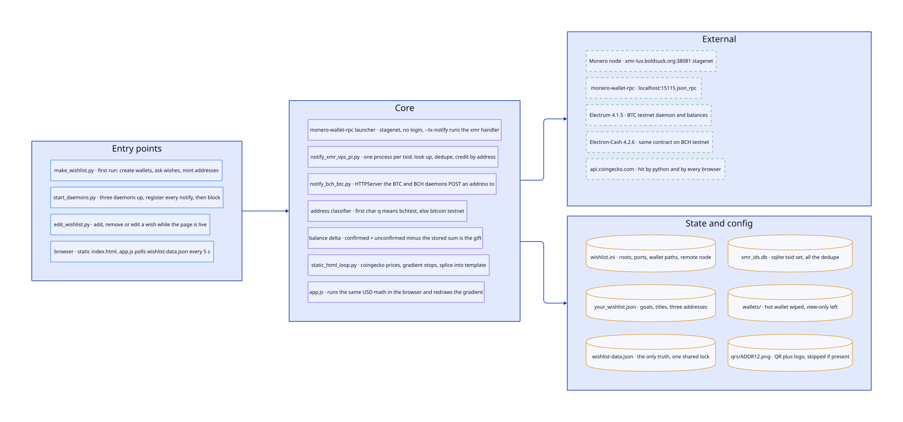

# HUMANS.md

A crypto crowdfunding page ("wishlist") where three wallet daemons — Monero, Bitcoin and Bitcoin Cash — watch their own addresses and rewrite a single JSON file that the page renders.

## Read it left to right

- **One JSON file is the whole site.** `www_root/data/wishlist-data.json` is the only thing the page renders; `your_wishlist.json`, the QR PNGs and `index.html` are all derived from it. Three processes rewrite it — setup, the XMR notifier and the BTC/BCH callback — and each one takes the same `FileLock`, so the lock is the only thing keeping the totals consistent.
- **The same maths exists twice, and so does the price feed.** `static_html_loop.py` renders the page for non-JS visitors every 5 minutes and `app.js` re-renders it in the browser every 5 seconds (only when `metadata.modified` moved). Both fetch CoinGecko themselves and neither stores a price, so the static page and a JS browser can show different dollar totals for the same coins.
- **A contribution is counted two completely different ways.** XMR is transaction-shaped: `--tx-notify` fires `notify_xmr_vps_pi.py` per txid, `xmr_ids.db` decides whether that tx was already credited, and the wish is found by exact subaddress match. BTC/BCH is balance-shaped: the daemon POSTs an address, the handler asks `getaddressbalance` and treats *current balance minus stored balance* as one new gift — so a spend silently lowers the total, and unconfirmed becoming confirmed is not a new contribution.
- **The coin is guessed from the address string.** The callback receives nothing but an address; the first character `q` means bchtest, anything else is treated as bitcoin testnet. That is the entire routing logic between the two daemons.
- **The wallets are deliberately half-dead.** Setup creates a real hot wallet, prints the seed once, overwrites the wallet and keys files with three random passes, then rebuilds a view-only wallet from the viewkey so the server can watch and never spend. Testnet and stagenet are hardcoded throughout (`--testnet`, `--stagenet`, `bchtest:`), so out of the box this cannot take mainnet money.

There is no supervisor: `start_daemons.py` starts the daemons, registers a notify per address and then blocks inside the BTC/BCH HTTP server, while the HTML refresh is a plain `os.system` child — a dead wallet daemon looks like a page that quietly stops moving.

---
Diagram source: [`docs/system.d2`](docs/system.d2) · render with [`scripts/render-diagram.sh`](scripts/render-diagram.sh) (writes `docs/system.svg` for light and dark, plus `docs/system.png`).
